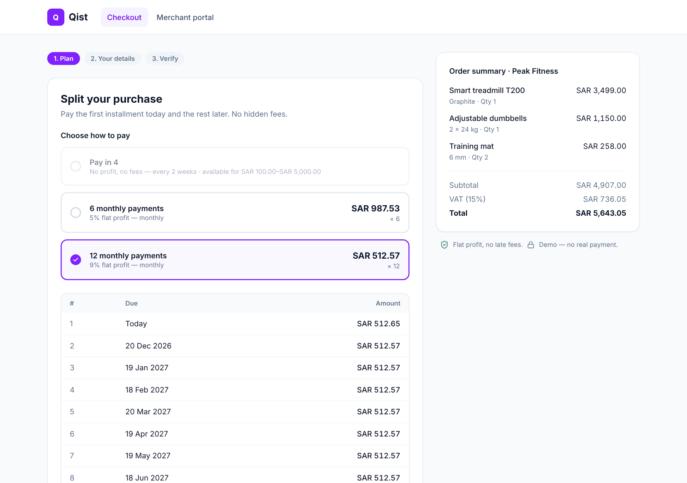
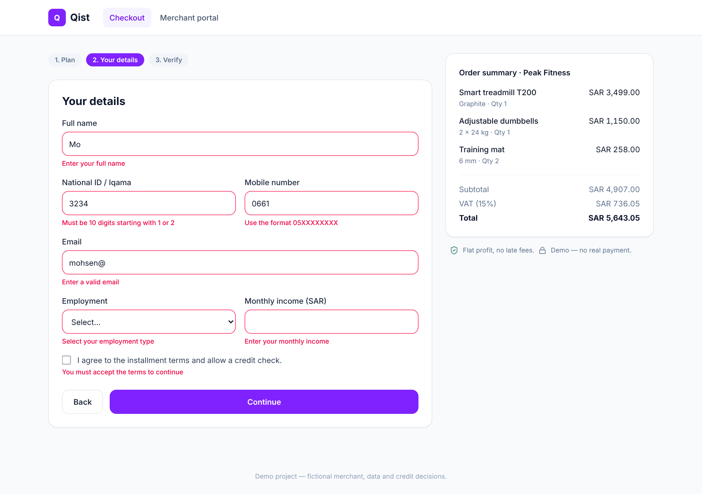
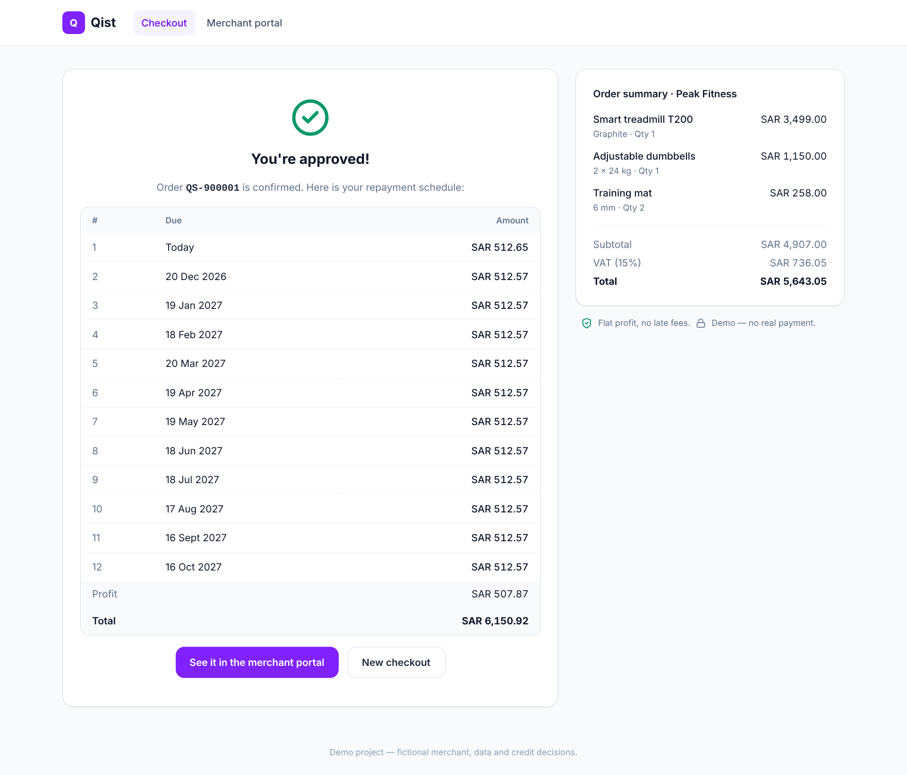
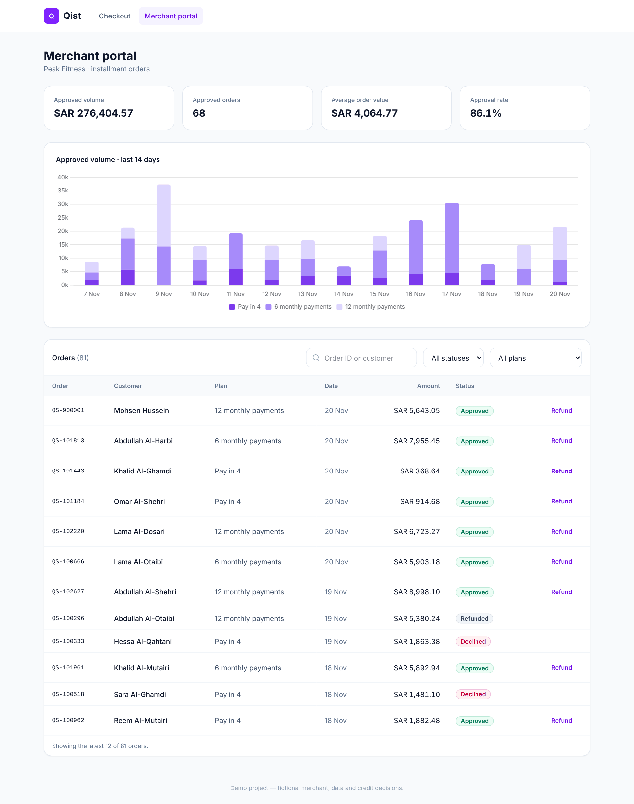

<div align="center">

# Qist · BNPL Checkout & Merchant Portal

**A Buy Now, Pay Later checkout and merchant dashboard built with React 19, TypeScript, Redux Toolkit, Formik and Chart.js.**

Installment math in integer halalas · Credit decision with a debt-burden check · Merchant KPIs and charts · Tested

[](https://github.com/Mohsen-Hussen/bnpl-checkout/actions/workflows/ci.yml)


**[▶ Live demo](https://mohsen-hussen.github.io/bnpl-checkout/)**



</div>

## About

Consumer-finance checkouts look simple but carry a lot of rules: which plans an order qualifies for, how installments are rounded, when each payment is due, and whether the customer can afford it. On top of that, the merchant needs to see what is happening.

This project models that end to end with a fictional merchant ("Peak Fitness") and a fictional provider ("Qist"):

1. **Checkout.** Pick a plan, enter your details, verify by OTP, and get an instant decision.
2. **Merchant portal.** Watch volume, approval rate and orders, and refund orders.

> This is a demo. No real payments or credit checks are made, and all data is fictional.

## Features

### Checkout

- **Three plans with eligibility rules.** Pay in 4 (no profit, bi-weekly), 6 months (5% flat) and 12 months (9% flat). Each plan has a minimum and maximum order value, and plans the cart doesn't qualify for are disabled with an explanation.
- **Exact installment math.** All money is stored as integer **halalas**, so installments always add up exactly to the total. The rounding remainder goes on the first payment (the one paid today). Due dates follow each plan's interval.
- **Formik + Yup application form.** It validates the Saudi national ID/Iqama, the mobile number (`05XXXXXXXX`), email, employment, minimum income and consent. Errors are linked to inputs with `aria-describedby` and announced with `role="alert"`.
- **OTP verification and a mock credit-decision API** (`createAsyncThunk`, with loading and error states):
  - A wrong code shows an inline error.
  - Approval uses a **debt-burden ratio** check: monthly-equivalent installments must be ≤ 33% of income.
  - A decline explains why and suggests a longer plan.
- **Focus management.** Each step moves focus to its heading, and the progress list uses `aria-current="step"`.

### Merchant portal

- **KPIs:** approved volume, approved orders, average order value and approval rate. These are memoized selectors (`createSelector`).
- **Stacked Chart.js bar chart** of approved volume per day for the last 14 days, split by plan.
- **Orders table:** search by ID or customer, filter by status and plan, and refund approved orders.
- **Code-split route.** The portal and Chart.js load only when the route is opened (React Router `lazy`).
- **Shared state.** Orders created at checkout appear in the portal right away. The store is persisted to `localStorage`.

## Screenshots

| Validation                                                                          | Approved, with repayment schedule                                                       |
| ----------------------------------------------------------------------------------- | --------------------------------------------------------------------------------------- |
|  |  |



## Tech stack

| Area    | Choice                                                                 |
| ------- | ---------------------------------------------------------------------- |
| UI      | React 19 · React Router 8 · Tailwind CSS 4 · lucide-react              |
| State   | Redux Toolkit 2 (slice, async thunk, memoized selectors) · React Redux |
| Forms   | Formik 2 · Yup                                                         |
| Charts  | Chart.js 4 · react-chartjs-2                                           |
| Tooling | Vite 8 · TypeScript 7 (strict) · Oxlint · Prettier                     |
| Testing | Vitest · React Testing Library · user-event · jsdom                    |

## Project structure

```
src/
├── app/store.ts                 # store factory, typed hooks, persistence
├── components/                  # Layout, Button, Card, Formik-aware fields, StatusBadge
├── features/
│   ├── cart/                    # demo cart and VAT totals
│   ├── installments/            # plans, schedule math, PlanSelector, ScheduleTable
│   ├── checkout/                # Yup schemas, mock decision API, CheckoutPage
│   ├── orders/                  # slice, thunk, selectors, deterministic seed data
│   └── merchant/                # MerchantPage, VolumeChart
└── router.tsx                   # routes, with the merchant portal lazy-loaded
```

The domain logic (`schedule.ts`, `plans.ts`, `api.ts`, selectors) is plain TypeScript with no React, so it is easy to test and reuse.

## Getting started

Requires Node.js 20.19+ or 22.12+.

```bash
git clone https://github.com/Mohsen-Hussen/bnpl-checkout.git
cd bnpl-checkout
npm install
npm run dev        # http://localhost:5173
```

Use the code **1234** on the verification step. Enter a low income (for example, SAR 2,500) to see a decline.

| Script              | What it does                        |
| ------------------- | ----------------------------------- |
| `npm run dev`       | Start the Vite dev server           |
| `npm run build`     | Type-check and build for production |
| `npm test`          | Run the Vitest suite                |
| `npm run lint`      | Oxlint                              |
| `npm run typecheck` | `tsc -b`                            |
| `npm run format`    | Format with Prettier                |

The live demo is deployed to GitHub Pages by [`pages.yml`](.github/workflows/pages.yml). It uses `BASE_PATH` for the sub-path and a `404.html` fallback for client-side routes.

## Testing

There are 33 tests:

- **Schedule math:** totals always match for every plan and amount, the remainder goes on the first payment, profit is applied, due dates are correct, and invalid input is rejected.
- **Rules:** plan eligibility, VAT, the Yup schema, the monthly-repayment conversion and the debt-burden decision.
- **Store:** the refund reducer, KPI and filter selectors (including memoization), daily volume buckets, and deterministic seed data.
- **Full checkout journey:** disabled plans, schedule updates, validation errors, a wrong OTP, approval, and a decline.

## License

[MIT](LICENSE) © Mohsen Hussein
